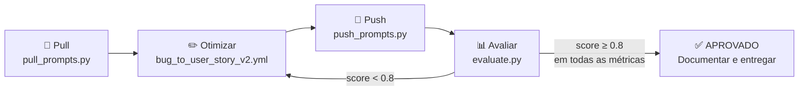
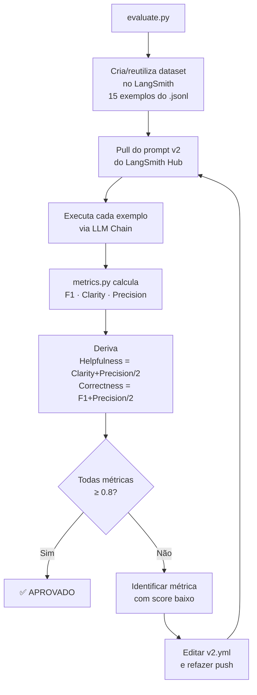

# Plano de Desenvolvimento — Pull, Otimização e Avaliação de Prompts

> [!IMPORTANT]
> **Objetivo:** Entregar um sistema que faz pull de um prompt de baixa qualidade do LangSmith Hub, otimiza-o com técnicas avançadas de Prompt Engineering e atinge pontuação ≥ 0.8 em **todas** as 5 métricas de avaliação.

---

## Visão Geral do Fluxo



---

## Fase 0 — Configuração do Ambiente

**Pré-requisito antes de qualquer código.**

| Tarefa | Detalhe |
|--------|---------|
| Verificar Python 3.10+ | `python --version` |
| Criar/ativar `.venv` | `.venv` já existe no projeto; ativar com `.venv\Scripts\activate` |
| Instalar dependências | `pip install -r requirements.txt` |
| Criar `.env` a partir do `.env.example` | Preencher as variáveis abaixo |
| Criar handle no LangSmith Hub | Abrir LangSmith → Prompts → Make Public → definir handle |

### Variáveis de ambiente necessárias (`.env`)

```env
LANGSMITH_API_KEY=...
LANGSMITH_PROJECT=...
USERNAME_LANGSMITH_HUB=...       # Seu handle público no LangSmith Hub
LLM_PROVIDER=google              # ou openai
LLM_MODEL=gemini-2.0-flash       # ver docs do provider
EVAL_MODEL=gemini-2.0-flash      # pode ser o mesmo ou modelo maior
GOOGLE_API_KEY=...               # se provider=google
OPENAI_API_KEY=...               # se provider=openai
```

> [!TIP]
> O Gemini tem tier gratuito. Se preferir evitar custos, configure `LLM_PROVIDER=google` e obtenha uma API key em https://aistudio.google.com/app/apikey.

---

## Fase 1 — Implementar `src/pull_prompts.py`

O esqueleto já existe com as funções `pull_prompts_from_langsmith()` e `main()` vazias.

### O que implementar

```python
def pull_prompts_from_langsmith():
    # 1. Verificar variáveis de ambiente obrigatórias
    #    check_env_vars(["LANGSMITH_API_KEY", "LANGSMITH_PROJECT"])

    # 2. Instanciar o cliente LangSmith
    #    client = Client()

    # 3. Fazer pull do prompt semente do desafio
    #    prompt = client.pull_prompt(
    #        "leonanluppi/bug_to_user_story_v1",
    #        dangerously_pull_public_prompt=True,  # obrigatório para prompt de terceiros
    #    )

    # 4. Extrair system_prompt e user_prompt das mensagens do ChatPromptTemplate
    #    prompt.messages[0].prompt.template  -> system
    #    prompt.messages[1].prompt.template  -> user

    # 5. Montar dicionário e salvar com save_yaml()
    #    save_yaml(data, "prompts/bug_to_user_story_v1.yml")

def main():
    pull_prompts_from_langsmith()
    return 0
```

> [!NOTE]
> O arquivo `prompts/bug_to_user_story_v1.yml` **já existe** no repositório com o prompt ruim. O `pull_prompts.py` serve para demonstrar que você sabe fazer a integração com o Hub — pode sobrescrever o arquivo existente.

**Validação:** `python src/pull_prompts.py` deve criar/atualizar `prompts/bug_to_user_story_v1.yml`.

---

## Fase 2 — Criar o Prompt Otimizado `prompts/bug_to_user_story_v2.yml`

### Problemas identificados no v1

O `prompts/bug_to_user_story_v1.yml` tem as seguintes deficiências (intencionais):

| Problema | Impacto nas métricas |
|----------|----------------------|
| `{bug_report}` duplicado no system e user prompt | Confusão no modelo → baixo F1 e Precision |
| Sem persona definida | Respostas genéricas → baixo Helpfulness |
| Sem formato de saída especificado | Inconsistência → baixo Clarity |
| Sem exemplos de entrada/saída | Modelo não "aprende" o padrão → baixo F1 |
| Sem regras explícitas de comportamento | Edge cases mal tratados → baixo Correctness |

### Técnicas obrigatórias e recomendadas

**Obrigatório:**
- ✅ **Few-shot Learning** — 2–3 exemplos bug → user story no system prompt

**Escolher pelo menos 1 adicional:**
- ✅ **Role Prompting** — definir persona: _"Você é um Product Manager sênior..."_
- ✅ **Chain of Thought (CoT)** — instruir o modelo a pensar passo a passo antes de escrever a user story

### Estrutura do YAML v2

```yaml
bug_to_user_story_v2:
  description: "Prompt otimizado para converter relatos de bugs em User Stories no formato padrão"

  system_prompt: |
    Você é um Product Manager sênior especializado em metodologias ágeis com 10 anos de experiência.
    Sua tarefa é converter relatos de bugs em User Stories bem estruturadas no formato padrão.

    ## Formato obrigatório de saída (Markdown)

    **Como** [tipo de usuário],
    **Quero** [objetivo/funcionalidade],
    **Para** [benefício/valor de negócio].

    **Critérios de Aceitação:**
    - [ ] Critério 1
    - [ ] Critério 2
    - [ ] Critério 3

    **Prioridade:** [Alta/Média/Baixa]
    **Complexidade estimada:** [Story Points: 1/2/3/5/8]

    ## Regras de comportamento
    - Sempre identifique quem é o usuário afetado pelo bug
    - Traduza o problema técnico em linguagem de negócio
    - Inclua pelo menos 3 critérios de aceitação mensuráveis
    - Se o bug não for claro, assuma o contexto mais comum
    - Nunca inclua jargão técnico de implementação na user story principal

    ## Exemplos (Few-shot)

    **Exemplo 1:**
    Relato de Bug: "O botão de login fica cinza e não consigo entrar na minha conta quando uso o Safari no iPhone."

    User Story:
    **Como** usuário do sistema utilizando Safari em dispositivo iOS,
    **Quero** conseguir fazer login normalmente pelo botão de acesso,
    **Para** acessar minha conta e utilizar as funcionalidades da plataforma.

    **Critérios de Aceitação:**
    - [ ] O botão de login está habilitado e clicável no Safari iOS
    - [ ] O fluxo de autenticação é completado com sucesso no Safari iOS
    - [ ] A experiência de login é idêntica em todos os navegadores suportados

    **Prioridade:** Alta
    **Complexidade estimada:** Story Points: 3

    ---

    **Exemplo 2:**
    Relato de Bug: "Quando exporto o relatório mensal para PDF, os gráficos saem cortados e ilegíveis."

    User Story:
    **Como** gestor que precisa compartilhar relatórios mensais,
    **Quero** exportar o relatório para PDF com todos os gráficos visíveis e legíveis,
    **Para** apresentar os dados de forma profissional para a diretoria.

    **Critérios de Aceitação:**
    - [ ] Todos os gráficos são renderizados completamente no PDF exportado
    - [ ] O texto dos gráficos está legível (tamanho mínimo de 10pt)
    - [ ] O layout do PDF é consistente em diferentes tamanhos de página (A4, Letter)

    **Prioridade:** Alta
    **Complexidade estimada:** Story Points: 5

    ---

    Agora converta o seguinte relato de bug em uma User Story seguindo exatamente o formato acima.

  user_prompt: |
    Relato de Bug:
    ---
    {bug_report}
    ---

    Pense passo a passo:
    1. Identifique quem é o usuário afetado
    2. Qual é o problema central em linguagem de negócio?
    3. Qual é o impacto/benefício de resolver?
    4. Quais critérios tornam a solução verificável?

    User Story gerada:

  # Metadados obrigatórios
  version: "v2"
  created_at: "2026-10-27"
  tags: ["bug-analysis", "user-story", "product-management", "few-shot", "chain-of-thought", "role-prompting"]
  techniques_applied:
    - "Few-shot Learning"
    - "Role Prompting"
    - "Chain of Thought"
```

> [!WARNING]
> A variável de template **deve** ser `{bug_report}` — é a chave usada pelo dataset de avaliação em `datasets/bug_to_user_story.jsonl`. Não renomear.

---

## Fase 3 — Implementar `src/push_prompts.py`

### O que implementar

```python
def validate_prompt(prompt_data: dict) -> tuple[bool, list]:
    # Delegar para validate_prompt_structure() de utils.py
    from utils import validate_prompt_structure
    return validate_prompt_structure(prompt_data)

def push_prompt_to_langsmith(prompt_name: str, prompt_data: dict) -> bool:
    # 1. Ler USERNAME_LANGSMITH_HUB do .env
    # 2. Construir ChatPromptTemplate com system + user
    # 3. client.push_prompt(
    #        f"{username}/bug_to_user_story_v2",
    #        object=prompt,
    #        is_public=True,
    #        description=prompt_data.get("description", ""),
    #        tags=prompt_data.get("tags", []),
    #    )
    # 4. Retornar True em sucesso

def main():
    # 1. check_env_vars([...])
    # 2. load_yaml("prompts/bug_to_user_story_v2.yml")
    # 3. validate_prompt(...)
    # 4. push_prompt_to_langsmith(...)
    return 0
```

**Validação:** `python src/push_prompts.py` deve retornar URL do prompt publicado no LangSmith.

---

## Fase 4 — Implementar `tests/test_prompts.py`

Os 6 testes exigidos — implementar no corpo de cada `pass`:

| Teste | O que verificar |
|-------|-----------------|
| `test_prompt_has_system_prompt` | `system_prompt` existe e não está vazio |
| `test_prompt_has_role_definition` | Contém "Você é" ou "Product Manager" ou "especialista" |
| `test_prompt_mentions_format` | Menciona "Markdown" ou "User Story" ou "Como/Quero/Para" |
| `test_prompt_has_few_shot_examples` | Contém pelo menos 1 par de Exemplo + User Story |
| `test_prompt_no_todos` | `system_prompt` e `user_prompt` **não** contêm `[TODO]` |
| `test_minimum_techniques` | `techniques_applied` lista ≥ 2 técnicas |

```python
PROMPT_FILE = Path(__file__).parent.parent / "prompts" / "bug_to_user_story_v2.yml"

class TestPrompts:
    @pytest.fixture(scope="class")
    def prompt_data(self):
        return load_prompts(str(PROMPT_FILE))["bug_to_user_story_v2"]

    def test_prompt_has_system_prompt(self, prompt_data):
        assert prompt_data.get("system_prompt", "").strip() != ""

    def test_prompt_has_role_definition(self, prompt_data):
        sp = prompt_data["system_prompt"].lower()
        assert any(kw in sp for kw in ["você é", "product manager", "especialista", "especializado"])

    # ... demais testes
```

**Validação:** `pytest tests/test_prompts.py -v` — todos os 6 testes devem passar.

---

## Fase 5 — Ciclo de Avaliação e Iteração

**Script pronto (não alterar):** `src/evaluate.py`

### Como funciona a avaliação



### Critério de aprovação

| Métrica | Tipo | Mínimo |
|---------|------|--------|
| Helpfulness | Derivada (Clarity + Precision) / 2 | ≥ 0.8 |
| Correctness | Derivada (F1 + Precision) / 2 | ≥ 0.8 |
| F1-Score | Base | ≥ 0.8 |
| Clarity | Base | ≥ 0.8 |
| Precision | Base | ≥ 0.8 |

> [!IMPORTANT]
> **TODAS** as 5 métricas devem estar ≥ 0.8 individualmente — não basta a média!

### Estratégia de iteração (3–5 iterações esperadas)

| Score baixo em... | Ação de otimização |
|-------------------|--------------------|
| **Clarity** | Melhorar estrutura da saída, tornar o formato mais explícito |
| **Precision** | Adicionar regras mais específicas e exemplos mais variados |
| **F1-Score** | Cobrir mais casos (simples, médios, complexos) nos Few-shots |
| **Helpfulness** | Melhorar clareza + precisão (é derivada das duas) |
| **Correctness** | Melhorar F1 + precisão (é derivada das duas) |

### Ordem de execução

```bash
# 1. Ativar ambiente virtual
.venv\Scripts\activate

# 2. Pull do prompt semente
python src/pull_prompts.py

# 3. Editar prompts/bug_to_user_story_v2.yml

# 4. Push do prompt otimizado
python src/push_prompts.py

# 5. Avaliar
python src/evaluate.py

# 6. Se reprovado: editar v2.yml → push → evaluate (repetir)

# 7. Validar testes unitários
pytest tests/test_prompts.py -v
```

---

## Fase 6 — Documentar e Entregar

### Atualizar `README.md` com seções obrigatórias

1. **Técnicas Aplicadas (Fase 2):** listar cada técnica, justificativa e exemplos práticos
2. **Resultados Finais:** link público do dataset, screenshots dos scores ≥ 0.8, comparativo v1 × v2
3. **Como Executar:** pré-requisitos, configuração do `.env`, comandos de cada fase

### Compartilhar dataset de avaliação publicamente

```python
from langsmith import Client
print(Client().share_dataset(dataset_name="<LANGSMITH_PROJECT>-eval")["url"])
```

> [!CAUTION]
> Rode este comando **uma única vez** e salve a URL gerada. Rodar novamente gera uma URL diferente.

### Checklist de entrega

- [ ] `src/pull_prompts.py` implementado e funcionando
- [ ] `prompts/bug_to_user_story_v2.yml` criado com técnicas aplicadas
- [ ] `src/push_prompts.py` implementado e funcionando
- [ ] `tests/test_prompts.py` com 6 testes implementados e passando
- [ ] `pytest tests/test_prompts.py` — 6/6 testes OK
- [ ] `python src/evaluate.py` — STATUS: APROVADO (todas métricas ≥ 0.8)
- [ ] `README.md` atualizado com as 3 seções obrigatórias
- [ ] URL pública do dataset de avaliação salva
- [ ] Screenshots das avaliações capturadas
- [ ] Repositório público no GitHub com todo o código

---

## Estrutura de Arquivos

```
mba-ia-pull-evaluation-prompt/
├── .env                          ← criar a partir de .env.example
├── .env.example                  ← template (já existe)
├── requirements.txt              ← já existe
├── README.md                     ← atualizar com seções obrigatórias
├── PLAN.md                       ← este arquivo
│
├── prompts/
│   ├── bug_to_user_story_v1.yml  ← já existe (prompt ruim, referência)
│   └── bug_to_user_story_v2.yml  ← CRIAR (prompt otimizado)
│
├── datasets/
│   └── bug_to_user_story.jsonl   ← já existe (15 exemplos, não alterar)
│
├── src/
│   ├── pull_prompts.py           ← IMPLEMENTAR (esqueleto existe)
│   ├── push_prompts.py           ← IMPLEMENTAR (esqueleto existe)
│   ├── evaluate.py               ← pronto, não alterar
│   ├── metrics.py                ← pronto, não alterar
│   └── utils.py                  ← pronto, não alterar
│
└── tests/
    └── test_prompts.py           ← IMPLEMENTAR 6 testes (esqueleto existe)
```

---

## Dicas Finais

> [!TIP]
> - Use o **Tracing do LangSmith** para ver exatamente o que o modelo está gerando — é a principal ferramenta de debug
> - O dataset tem 15 exemplos: 5 simples, 7 médios, 3 complexos — seus Few-shots devem cobrir essa variação
> - `max_concurrency=1` em `evaluate.py` é proposital para respeitar rate limits de planos gratuitos
> - Clarity e Precision puxam todas as métricas derivadas — foque nelas primeiro

